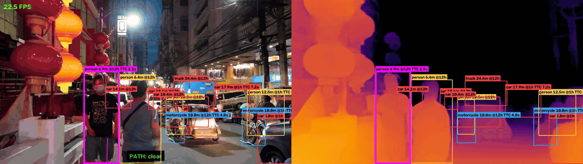
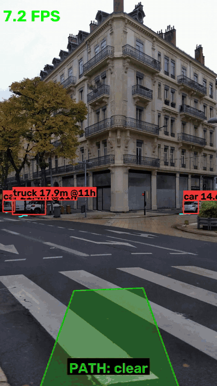
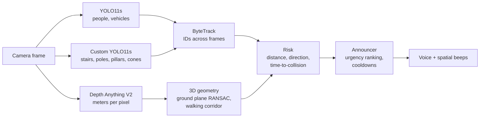

# Blind Navigation Assistant

An AI assistant that helps visually impaired people walk safely. From a single camera it
works out **what** is around, **where** it is, **how far** it is and **whether it is coming
closer**. It speaks only when it matters: *"Stop! Car approaching at 2 o'clock, 3 meters"*.

<p align="center">
  <br>
  
</p>

*Left: camera view with detections, distance, clock direction and time-to-collision. Right: the
depth map. The subtitles show what the assistant says out loud.*

---

## What makes it different

A basic "YOLO + text-to-speech" project announces every detected object. A blind user can't
work with that: it's constant noise, and it hides the sounds they rely on (traffic, footsteps).
This project focuses on deciding **what deserves to be said**:

| | Basic version | This project |
|---|---|---|
| Distance | — | Metric depth estimation, **auto-calibrated** from the ground plane |
| Unknown obstacles | Only the 80 COCO classes | **3D walking corridor**: anything that sticks out of the ground in your path, even objects no model knows |
| Head-level obstacles | — | Flagged separately (a white cane can't detect them) |
| Motion | — | Tracking + **time-to-collision** from looming (scale-independent) |
| Speech | Every object, every frame | Ranked by urgency, with persistence, cooldowns and escalation (~3 messages/min) |
| Direction | Left/right | **Clock positions** (the convention taught in orientation & mobility training) + stereo beeps from the obstacle's side |
| Languages | — | English and French |

## How it works



1. **Detection** ([detector.py](src/blindnav/detector.py)): two YOLO11s models run on every frame.
   One is pretrained on COCO (people, vehicles). The other I fine-tuned on Kaggle for street
   hazards COCO doesn't know ([notebook](notebooks/train_hazards_results.ipynb)).
2. **Depth** ([depth.py](src/blindnav/depth.py)): Depth Anything V2 (metric, outdoor) gives a distance
   for every pixel. Preprocessing runs on the GPU in FP16.
3. **3D geometry** ([spatial.py](src/blindnav/spatial.py)): the depth map is back-projected to 3D
   points (pinhole model). **RANSAC** finds the ground plane. Knowing the camera is ~1.4 m above
   the ground **corrects the depth scale automatically**. Anything rising 0.25–2 m above the
   ground inside a 1 m wide corridor counts as an obstacle, whatever it is.
4. **Tracking & time-to-collision** ([risk.py](src/blindnav/risk.py)): ByteTrack keeps object
   IDs. TTC comes from **looming** (TTC = size / growth rate), which needs no depth at all, so
   depth scale errors don't affect it.
5. **Announcer** ([announcer.py](src/blindnav/announcer.py)): urgency = max(proximity in the path,
   time-to-collision) × collision severity. An alert is spoken only if it persists ≥ 0.2 s, at
   most one message every 2 s, never repeated unless it got closer or more urgent.
6. **Speech** ([speech.py](src/blindnav/speech.py)): Windows text-to-speech plus a beep panned to the
   obstacle's side. For video files, the soundtrack is placed at exact video timestamps and
   muxed with ffmpeg.

## Results

Full per-clip results: [docs/evaluation.md](docs/evaluation.md) (generated by
[scripts/evaluate.py](scripts/evaluate.py) on 10 test clips).

| Metric | Result |
|---|---|
| Speed (RTX 2050 laptop GPU, 4 GB) | **16–19 FPS** on landscape 1080p–1440p clips, ~5 FPS on portrait 4K clips |
| False alarms on clips where it should stay silent | **0** in 1.5 min of video |
| Speaking rate | **3.4 messages / minute** on average |
| Distance consistency (people) | depth vs. person-height estimate: median ratio **1.12** over 3,299 measurements |
| Custom hazard model (test set) | mAP50 **0.56** (cone 0.94, pillar 0.75, pole 0.59, stairs 0.57) |
| Real-time optimizations | GPU preprocessing, 392 px depth every 2 frames, FP16: **~2x faster** (8.7 → 17.8 FPS) with the same alerts on 4/5 clips |

## Known limitations

I'd rather state these clearly than hide them:

- **Domain shift:** the hazard model was trained on South Asian street footage (rickshaws, CNG
  three-wheelers). It scores 0.56 mAP50
  on its own test set but barely fires on European streets. Better results need training data
  closer to the target streets.
- **Stairs:** announced as a generic "obstacle". I tested a geometric "step down" detector. It
  can't tell stairs going up from stairs going down without knowing the direction of gravity,
  so I didn't ship it. A wrong safety warning is worse than none. The phone's accelerometer
  would solve this.
- **Thin bollards** are too thin for the depth map and absent from the training data.
- **Crossing objects** get no time-to-collision (looming only measures approach). Close
  objects in the path are still announced through proximity.
- **Absolute distances** come from monocular depth plus a 1.4 m camera-height assumption, so
  they're estimates, not measurements.
- Tested on stock footage, not yet with visually impaired users. The live webcam mode is
  implemented, but end-to-end testing so far used recorded video.

## Run it

Windows, Python 3.10+, an NVIDIA GPU recommended.

```powershell
python -m venv .venv
.venv\Scripts\activate
pip install torch torchvision --index-url https://download.pytorch.org/whl/cu126
pip install -r requirements.txt
pip install -e .

# Run on a video: writes data/outputs/<name>_demo.mp4 with the voice soundtrack
python scripts/run_video.py path/to/video.mp4
python scripts/run_video.py path/to/video.mp4 --lang fr    # French voice

# Live webcam: speaks in real time
python scripts/run_video.py 0

# Measure speed per stage, evaluate on all clips
python scripts/benchmark.py path/to/video.mp4
python scripts/evaluate.py
```

YOLO11s and Depth Anything V2 download automatically. The custom hazard model (`models/hazards.pt`)
is optional: train it with [notebooks/train_hazards.ipynb](notebooks/train_hazards.ipynb) on Kaggle
(GPU, ~40 min). Test clips are free Pexels videos listed in [data/SOURCES.md](data/SOURCES.md).

## Project structure

```
src/blindnav/
  detector.py    YOLO detection + ByteTrack tracking
  depth.py       monocular metric depth (GPU preprocessing, FP16)
  spatial.py     3D back-projection, RANSAC ground plane, scale calibration, walking corridor
  risk.py        looming time-to-collision, approach speed
  announcer.py   urgency ranking, cooldowns, EN/FR messages
  speech.py      text-to-speech, spatial beeps, synced soundtrack
  visualize.py   overlays and subtitles
scripts/         run_video.py, benchmark.py, evaluate.py
notebooks/       Kaggle training notebook (+ executed version with results)
docs/            evaluation results, demo GIFs
```

## Credits and licenses

- [Ultralytics YOLO11](https://github.com/ultralytics/ultralytics) (AGPL-3.0), which is why this
  project is licensed under **AGPL-3.0**
- [Depth Anything V2](https://github.com/DepthAnything/Depth-Anything-V2), Small metric outdoor model (Apache-2.0)
- Training data: *Object Detection Dataset: Navigation Assistance for the Visually Impaired People
  using YOLOv11*, Mendeley Data, [doi:10.17632/m68g3h7p87.1](https://doi.org/10.17632/m68g3h7p87.1) (CC BY 4.0)
- Test videos: [Pexels](https://www.pexels.com/license/) (not redistributed, see [data/SOURCES.md](data/SOURCES.md))
